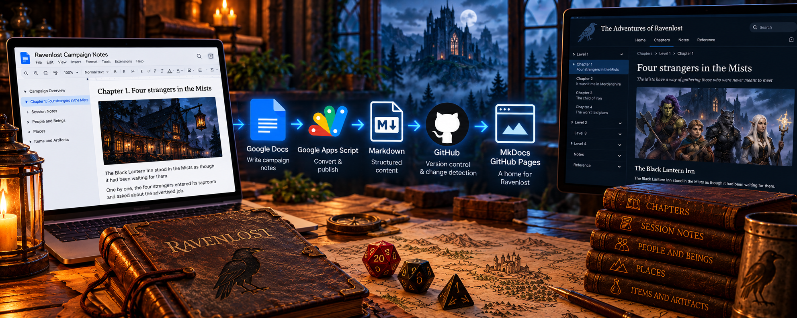

# From Google Docs to GitHub Pages: Automating My D&D Campaign Notes

  October 14, 2026
  Google Docs
  MkDocs
  GitHub Pages

I play in a Dungeons & Dragons campaign called Ravenlost. Like most long-running campaigns, ours has accumulated a lot of information: characters, locations, important items, session recordings and notes, and an ongoing story.

I wanted a way for our group to revisit that information without digging through months of notes. So I built [The Adventures of Ravenlost](https://abartzgit.github.io/ravenlost/), a website that organizes our campaign into chapters, session notes, and reference material.

The website uses MkDocs and Material for MkDocs, and it's hosted on GitHub Pages. But the more interesting part of the project is how the content gets there.

I built a publishing workflow that converts Google Docs into Markdown, detects changes, and publishes updates to GitHub.

## The challenge: Writing in one place, publishing in another

I wanted to keep Google Docs as my writing environment. It's convenient for drafting chapters, organizing notes, and making changes without worrying about Markdown syntax. It also allows for collaboration among the other members of Ravenlost who don't use GitHub.

But I also wanted the published content to live in GitHub, where I could manage it as a documentation site.

Manually copying content from Google Docs into Markdown files would have worked initially, but it would have become tedious as the campaign grew. It also introduced opportunities for mistakes, particularly when handling formatting, images, and links.

My goal was to separate content creation from publishing. I wanted to write in Google Docs, click a button when the content was ready, and let the publishing workflow handle the conversion.

## The architecture

The workflow uses several familiar documentation tools:

- **Google Docs:** The source content, including chapter narratives, session notes, and reference information.
- **Google Apps Script:** The publishing engine that reads documents and converts their contents.
- **Markdown:** The output format used by the website.
- **GitHub API:** The mechanism for publishing changed Markdown files to the repository.
- **MkDocs with Material for MkDocs:** The static-site generator and website theme.
- **GitHub Pages:** Hosting for the finished site.

The workflow is straightforward:

**Google Docs → Google Apps Script → Markdown → GitHub → MkDocs → GitHub Pages**

Publishing content to GitHub and deploying the website are separate operations. The script updates the repository, while I currently deploy the site manually using MkDocs after reviewing new commits.

## Structured content and templates

The campaign content is organized into multiple tabs in Google Docs. Each tab corresponds to a particular chapter, set of session notes, or reference page.

Google Apps Script reads the configured tabs and converts their contents into Markdown files in the appropriate repository locations.

I use templates to keep different content types consistent. Chapter narratives and session notes have different purposes, so they don't need identical structures.

The conversion process also handles document formatting, including headings, emphasis, lists, links, tables, and images.

This is one of the areas where the project started to resemble a small content management system. Google Docs serves as the editing interface, while the script handles the rules for transforming and publishing content.

## Testing before publishing

One feature I wanted from the beginning was the ability to test changes without publishing them.

The Google Docs menu provides two actions:

- **Test build:** Generates Markdown output in a Google Drive test folder without creating GitHub commits.
- **Publish changes to GitHub:** Generates the Markdown and publishes changed files to the repository.

The test build became particularly useful while developing the Markdown conversion logic. I could inspect the output, identify formatting problems, make adjustments, and run the test again.

This was especially important for images. Getting images from Google Docs into the correct format for a MkDocs site required additional handling, and the test workflow made it easier to validate the generated paths before publishing.

## Publishing only what changed

Another requirement was avoiding unnecessary GitHub commits.

The publishing script compares generated content with the existing files in the repository. If a file is new or has changed, the script commits it directly to the main branch. Unchanged files are skipped. This means I can run the publishing process after editing a single session note without rewriting every chapter and reference page. It also makes the GitHub history more meaningful because commits correspond to actual content changes.

## Extending the workflow to reference material

As the campaign developed, I added reference pages for people and beings, places, and important items. These pages have a different structure from the chapter narratives. Some use tables to organize information, and they need to be updated as the party discovers new details.

Rather than maintain them manually in Markdown, I extended the existing publishing workflow to handle reference content as well. The result is a consistent process for maintaining several different types of documentation from Google Docs.

## What I learned

Although this started as a personal project, it gave me an opportunity to apply several documentation engineering concepts in a practical setting.

**Structured authoring makes automation easier.** Consistent document organization and templates make it possible to transform content reliably.

**Testing matters even for documentation.** A test build is valuable when content transformations involve formatting, images, and multiple output files.

**Publishing and deployment don't have to be the same operation.** Separating them gives me control over when content changes are committed and when the website is updated.

**Content reuse and consistency are easier with templates.** A predictable structure helps keep the site organized as the number of chapters and reference pages grows.

Most importantly, the project demonstrates that a relatively small collection of tools can support a complete publishing workflow without requiring a traditional CMS.

## What's next?

As the campaign continues, I'll keep adding chapters, updating reference material, and refining the publishing workflow.

For now, I have a system that lets me concentrate on writing the story rather than manually maintaining the website. And when someone wants to revisit an earlier adventure, the information is organized and available in one place.

**Explore the project:** [The Adventures of Ravenlost](https://abartzgit.github.io/ravenlost/)
